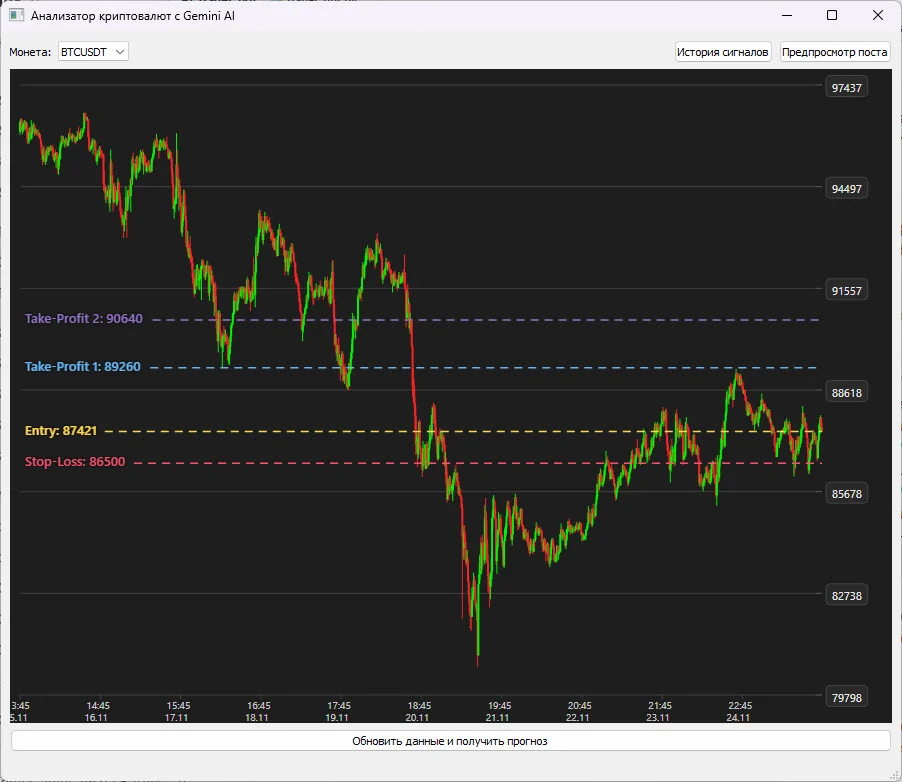

# AI_trader_bot

Приложение загружает свечи Binance, показывает график и передаёт числовые данные в Gemini. Из текстового ответа извлекаются уровни Stop-Loss и двух Take-Profit, которые сохраняются в SQLite и отображаются поверх графика. Перед публикацией в Telegram пользователь видит предпросмотр.

**Python-портфолио Евгения Толмачева** · Python · PyQt5 · Qt WebEngine · Gemini API · SQLite · Telegram Bot API



## Возможности

- Догружает новые пятнадцатиминутные свечи выбранного инструмента и сохраняет их локально.
- Выполняет запрос к Gemini в отдельном потоке и разбирает уровни из ответа модели.
- Показывает уровни на графике, сохраняет историю сигналов и позволяет открыть предыдущий результат.
- Готовит изображение и текст публикации и отправляет их в Telegram после подтверждения в окне предпросмотра.

## Как устроен проект

### Сценарий анализа

`AI_trader_bot.py`, `config.py`

MainWindow управляет загрузкой и действиями пользователя, GeminiWorker получает ответ модели, config задаёт параметры и шаблон запроса.

### Хранилище

`database_manager.py`

Создаёт базы SQLite, сохраняет свечи и уровни, возвращает историю и удаляет выбранные записи.

### График и изображение

`ui_widgets.py`, `post_generator.py`

Отображают HTML-график в Qt WebEngine, добавляют уровни и формируют изображение публикации.

### Telegram

`tg_poster.py`

Собирает подпись, показывает предпросмотр и отправляет изображение с текстом.

## Технологии и их роль

- **PyQt5 и Qt WebEngine**: Настольный интерфейс, рабочий поток анализа и встроенный HTML-график.
- **Requests и Gemini API**: Получение котировок и запрос анализа по подготовленным данным.
- **SQLite**: Локальная история свечей и результатов анализа.
- **python-telegram-bot**: Отправка подготовленной публикации в Telegram.

## Что смотреть в коде

Для знакомства с архитектурой откройте MainWindow и GeminiWorker, затем database_manager.py и tg_poster.py: они показывают разделение данных, анализа и публикации.

## Структура

```text
AI_trader_bot/
├── docs/
│   └── preview.webp
├── .env.example
├── .gitignore
├── AI_trader_bot.py
├── config.py
├── database_manager.py
├── post_generator.py
├── README.md
├── README.public.md
├── requirements.txt
├── tg_poster.py
└── ui_widgets.py
```

## Подготовка и запуск

Это сохранённая версия пет-проекта, показывающая этап развития навыков. Для воспроизведения создайте отдельное окружение Python, совместимое с зафиксированными зависимостями:

```powershell
python -m venv .venv
.venv\Scripts\Activate.ps1
python -m pip install -r requirements.txt
```

Задайте GOOGLE_API_KEY, TELEGRAM_BOT_TOKEN и TELEGRAM_CHANNEL_ID. Рабочая база и история сигналов исключены. Анализ модели не гарантирует правильность сигналов; в этой публикации не заявлена проверенная система автоматической торговли.

Переменные окружения: `GOOGLE_API_KEY`, `TELEGRAM_BOT_TOKEN`, `TELEGRAM_CHANNEL_ID`. Образец находится в [.env.example](.env.example). Сам файл .env автоматически не загружается: исходники читают окружение процесса. Значения нужно передать перед запуском, например в PowerShell:

```powershell
$env:GOOGLE_API_KEY = "YOUR_VALUE"
```

После подготовки настроек и необходимых данных основная точка входа:

```powershell
python AI_trader_bot.py
```

`requirements.txt` сохранён из проекта. Это снимок окружения, а не гарантия совместимости с новейшей версией Python. Для старых проектов могут потребоваться соответствующая версия Python и настройка системных компонентов.

## Контекст проекта

Проект 2025 года объединяет настольный интерфейс, локальное хранилище и AI API. Модули данных, графика и публикации разделены. Реализован сценарий анализа и подготовки сообщения; исполнение биржевых ордеров в этом приложении не предусмотрено.

## Состав публикации

В репозитории оставлены авторские исходники, зависимости и один компактный скриншот. Виртуальные окружения, сторонние библиотеки, рабочие базы, модели, большие наборы данных и персональные настройки не включены.

Чувствительные значения заменены понятными заглушками `YOUR_...` / `REDACTED_...`. Настоящие доступы не следует добавлять в Git. Алгоритмы и структура проекта при подготовке публикации не перерабатывались.

Проверена синтаксическая корректность Python-файлов и выполнено сканирование публикуемой копии на секреты. Полный запуск с внешними API, платежами, биржевыми операциями и локальными моделями не выполнялся.

Автор: [Евгений Толмачев](https://github.com/EvgenyET) · [Портфолио](https://evgeny.tech/)
